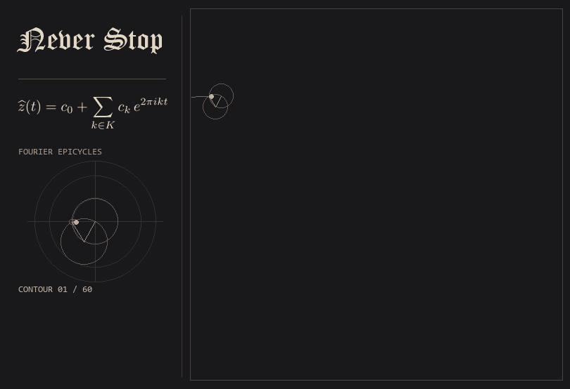

**BSc in Scientific Computing · UNMSM**

My interests span applied mathematics, AI and machine learning, and quantitative finance. I use this GitHub to keep my study notes and code.

<!-- language-card:start -->
<picture>
  <source media="(max-width: 600px)" srcset="assets/languages-mobile.svg">
  
</picture>
<!-- language-card:end -->

